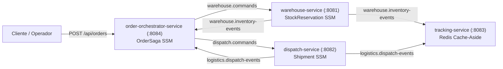
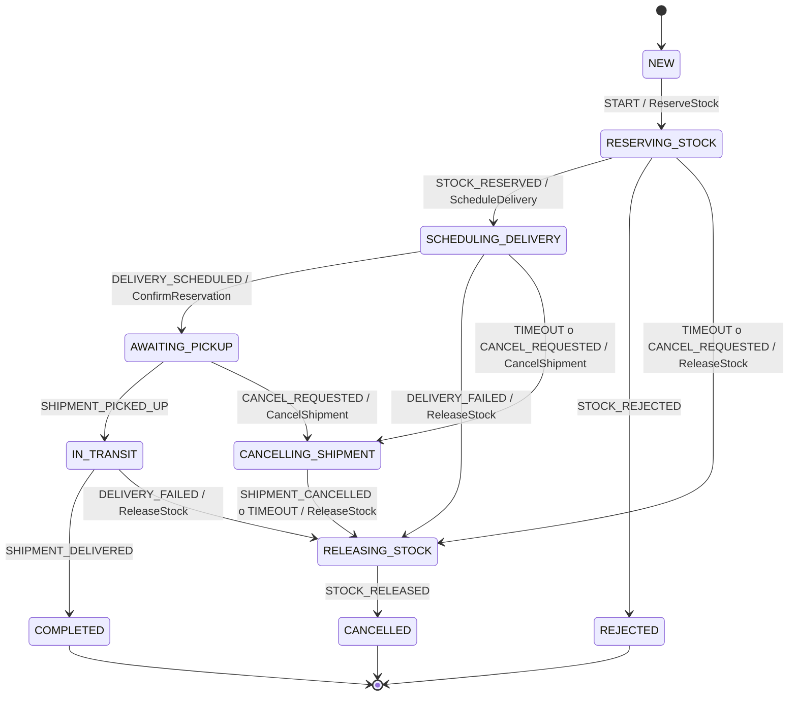

# FastDrop Logistics Platform 🚚📦

Plataforma distribuida de logística y fulfillment de envíos construida con **Java 21+**, **Spring Boot 3.3.4**, **Spring State Machine 4.0**, **Arquitectura Hexagonal (Ports & Adapters)**, **PostgreSQL 16**, **Apache Kafka (KRaft)**, **Redis 7**, **Resilience4j**, **Virtual Threads**, **ArchUnit**, **JaCoCo** y **OpenTelemetry / Zipkin**.

---

## 🏛️ Arquitectura del Sistema (Hexagonal + Spring State Machine)

El sistema implementa una **Saga Orquestada con máquinas de estado en dos niveles** y **Arquitectura Hexagonal estricta** validada automáticamente con ArchUnit (ver [plan-state-machine-hexagonal.md](docs/plan-state-machine-hexagonal.md), [ADR-004](docs/adr/0004-spring-state-machine-hexagonal.md) y [ADR-005](docs/adr/0005-orchestrated-saga-state-machine.md)):



### Microservicios y Módulos

1. **`common-statemachine` (Módulo Compartido):**
   - **`com.fastdrop.statemachine.api` (Java puro):** `TransitionSubject<S>`, `StateMachinePort<C,S,E>`, `TransitionResult<S>`, `InvalidStateTransitionException` y `StateTransitionFailedException`. Permite que la capa `application` dispare transiciones sin depender de Spring State Machine.
   - **`com.fastdrop.statemachine.ssm` (Infraestructura):** `AbstractStateMachineAdapter` (rehidratación desde el estado persistido de la entidad, disparo síncrono en el mismo hilo/transacción y propagación de excepciones lanzadas en actions), `ContextAwareGuard`, `ContextAwareAction` y `MetricsStateMachineListener` (métricas Micrometer).

2. **`common-events` (Contratos de Integración):**
   - Comandos del orquestador (`ReserveStockCommand`, `ConfirmReservationCommand`, `ReleaseStockCommand`, `ScheduleDeliveryCommand`, `CancelShipmentCommand`), eventos de dominio (`StockReservedEvent`, `StockReservationRejectedEvent`, `StockCancelledEvent`, `DeliveryScheduledEvent`, `ShipmentPickedUpEvent`, `ShipmentDeliveredEvent`, `DeliveryFailedEvent`, `ShipmentCancelledEvent`) y propagación W3C `traceparent`.

3. **`order-orchestrator-service` (`:8084`):**
   - Coordina el ciclo de vida punta a punta mediante la máquina de estados **`OrderSaga`**.
   - Publica comandos hacia `warehouse.commands` y `dispatch.commands` mediante **Transactional Outbox**.
   - Garantiza idempotencia de respuestas con la tabla `processed_messages` y gestiona timeouts por paso con `SagaTimeoutScheduler` (`SELECT ... FOR UPDATE SKIP LOCKED`).

4. **`warehouse-service` (`:8081`):**
   - Arquitectura hexagonal con modelos de dominio puros (`StockReservation`, `InventoryItem`) separados de las entidades JPA (`*JpaEntity` con `@Version`).
   - Máquina de estados local **`StockReservation`** con evaluación de stock mediante pseudo-estado *choice* (`STOCK_CHECK`).
   - Si una entrega falla en cualquier instancia (incluso estando `CONFIRMED` tras haber salido en tránsito), la transición `CONFIRMED --CANCEL--> CANCELLED` ejecuta `ReleaseStockAction` y devuelve el stock físico al inventario disponible.

5. **`dispatch-service` (`:8082`):**
   - Arquitectura hexagonal con máquina de estados local **`Shipment`**.
   - Separa la creación del envío (`TX1: PENDING_ROUTING`), la llamada externa a la API de ruteo protegida por **Resilience4j** (Circuit Breaker + Retry + Fallback **fuera de la transacción de base de datos**) y la aplicación del resultado (`TX2: ROUTE_ASSIGNED` o `ROUTE_FAILED`), con recuperación automática mediante `PendingRoutingRecoveryScheduler`.

6. **`tracking-service` (`:8083`):**
   - Consultas de alta concurrencia con **Virtual Threads** (`spring.threads.virtual.enabled=true`), **Cache-Aside en Redis** (TTL 30s), invalidación reactiva por eventos de Kafka, control de precedencia de estados y **Rate Limiting** con Resilience4j.

---

## 🔄 Máquinas de Estado

### 1.Nivel Proceso: `OrderSaga` (`order-orchestrator-service`)



### 2. Nivel Entidad: `StockReservation` (`warehouse-service`) y `Shipment` (`dispatch-service`)

| Servicio | Agregado | Estados | Eventos (Triggers) |
|---|---|---|---|
| `warehouse-service` | `StockReservation` | `NEW`, `STOCK_CHECK` (*choice*), `RESERVED`, `CONFIRMED`, `REJECTED`, `CANCELLED` | `RESERVE`, `CONFIRM`, `CANCEL` |
| `dispatch-service` | `Shipment` | `PENDING_ROUTING`, `SCHEDULED`, `IN_TRANSIT`, `DELIVERED`, `FAILED`, `CANCELLED` | `ROUTE_ASSIGNED`, `ROUTE_FAILED`, `PICK_UP`, `DELIVER`, `DELIVERY_FAILED`, `CANCEL` |

---

## 📂 Estructura del Proyecto

```
logistica/
├── .github/
│   ├── workflows/ci.yml          # Pipeline CI (Build, Tests, ArchUnit, Reportes JUnit y JaCoCo)
│   └── dependabot.yml            # Actualización semanal de dependencias Maven y GitHub Actions
├── common-events/                # Eventos de dominio, comandos de Saga y DTOs compartidos
├── common-statemachine/          # Puerto agnóstico (api) y adaptador base Spring State Machine (ssm)
├── order-orchestrator-service/   # Orquestador de Saga (OrderSaga SSM + Outbox + Timeouts)
├── warehouse-service/            # Hexagonal + StockReservation SSM + Optimistic Locking + Outbox
├── dispatch-service/             # Hexagonal + Shipment SSM + Resilience4j + Outbox
├── tracking-service/             # Redis Cache-Aside + Virtual Threads + Rate Limiter
├── docker/
│   └── init-databases.sql        # Inicialización de warehouse_db, dispatch_db y orchestrator_db
├── docker-compose.yml            # Infraestructura (Postgres 16, Kafka KRaft, Redis 7, Zipkin)
├── docs/
│   ├── plan-state-machine-hexagonal.md
│   ├── adr/                      # ADR-001 a ADR-005
│   └── c4-model/                 # Diagramas C4 en PlantUML (Context, Containers, Components)
└── k8s/base/                     # Manifiestos de Kubernetes con Probes (Liveness/Readiness/Startup)
```

Dentro de cada servicio hexagonal (`warehouse-service`, `dispatch-service`, `order-orchestrator-service`):

```
com.fastdrop.<service>
├── domain
│   ├── model/                    # Agregados puros (sin JPA/Spring), Value Objects y Enums State/Event
│   ├── event/ o command/         # Eventos/comandos internos de dominio
│   └── exception/                # Excepciones de negocio
├── application
│   ├── port/in/                  # Casos de uso y Commands de entrada
│   ├── port/out/                 # Puertos de salida (Repositories, StateMachinePort, Messaging, Routing)
│   └── service/                  # Implementación de casos de uso (@Transactional)
└── infrastructure
    └── adapter
        ├── in/                   # REST Controllers, Kafka Listeners, Schedulers
        └── out/                  # JPA Persistence + Mappers, Spring State Machine Config/Adapter, Outbox
```

---

## 🚀 Puesta en Marcha

### 1. Iniciar Infraestructura
```bash
docker compose up -d
```
Levanta:
- **PostgreSQL 16** en `localhost:5432` (`warehouse_db`, `dispatch_db`, `orchestrator_db`).
- **Apache Kafka (KRaft)** en `localhost:9092`.
- **Redis 7** en `localhost:6379`.
- **Zipkin** en `http://localhost:9411`.

### 2. Compilar, Ejecutar Pruebas y Generar Cobertura JaCoCo
```bash
mvn -B -ntp clean verify
```
Ejecuta:
- Pruebas unitarias y de máquinas de estado (`common-statemachine`, `warehouse-service`, `dispatch-service`, `order-orchestrator-service`, `tracking-service`).
- Reglas de **ArchUnit** (`*HexagonalArchitectureTest`) que verifican que `domain` y `application` no dependan de infraestructura, JPA ni Spring State Machine.
- Reportes HTML/XML de cobertura **JaCoCo** en `target/site/jacoco/index.html` de cada módulo.

### 3. Ejecutar los Microservicios
```bash
# Terminal 1: Warehouse Service (:8081)
mvn -pl warehouse-service spring-boot:run

# Terminal 2: Dispatch Service (:8082)
mvn -pl dispatch-service spring-boot:run

# Terminal 3: Order Orchestrator Service (:8084)
mvn -pl order-orchestrator-service spring-boot:run

# Terminal 4: Tracking Service (:8083)
mvn -pl tracking-service spring-boot:run
```

---

## 🌐 Endpoints Principales y Escenarios de Prueba

### Escenario 1: Camino Feliz Completo (`COMPLETED`)

1. **Inicializar Stock en Warehouse (`:8081`):**
   ```bash
   curl -X POST http://localhost:8081/api/inventory/init \
     -H "Content-Type: application/json" \
     -d '{"sku": "LAPTOP-01", "warehouseId": "WH-CENTRAL-01", "totalStock": 10}'
   ```

2. **Crear Orden en el Orquestador (`:8084` — `NEW -> RESERVING_STOCK -> SCHEDULING_DELIVERY -> AWAITING_PICKUP`):**
   ```bash
   curl -X POST http://localhost:8084/api/orders \
     -H "Content-Type: application/json" \
     -d '{"orderId": "ORD-100", "customerId": "CUST-01", "sku": "LAPTOP-01", "quantity": 1, "deliveryAddress": "Av. Corrientes 1234, CABA"}'
   ```

3. **Registrar Retiro y Entrega en Dispatch (`:8082` — `SCHEDULED -> IN_TRANSIT -> DELIVERED`):**
   ```bash
   curl -X POST http://localhost:8082/api/shipments/ORD-100/pick-up
   curl -X POST http://localhost:8082/api/shipments/ORD-100/deliver
   ```

4. **Consultar Estado de la Saga y Tracking (`:8084` y `:8083`):**
   ```bash
   curl http://localhost:8084/api/orders/ORD-100
   curl http://localhost:8083/api/shipments/ORD-100/tracking
   ```

### Escenario 2: Fallo en Asignación de Ruta y Compensación Automática (`CANCELLED`)

1. **Activar simulación de fallo en Dispatch (`:8082`):**
   ```bash
   curl -X POST "http://localhost:8082/api/shipments/simulate-fail?enabled=true"
   ```

2. **Crear Orden en el Orquestador (`:8084`):**
   ```bash
   curl -X POST http://localhost:8084/api/orders \
     -H "Content-Type: application/json" \
     -d '{"orderId": "ORD-200", "customerId": "CUST-02", "sku": "LAPTOP-01", "quantity": 1, "deliveryAddress": "Zona Sin Cobertura"}'
   ```
   - `dispatch-service` activa el fallback de Resilience4j, pasa el envío a `FAILED` y publica `DeliveryFailed`.
   - `order-orchestrator-service` transiciona `SCHEDULING_DELIVERY -> RELEASING_STOCK` y envía `ReleaseStockCommand`.
   - `warehouse-service` transiciona `RESERVED -> CANCELLED`, libera el stock y publica `StockCancelled`.
   - `order-orchestrator-service` finaliza en `CANCELLED`.

### Escenario 3: Fallo de Entrega en Tránsito y Devolución de Stock al Warehouse (`CANCELLED`)

1. **Desactivar simulación de fallo, crear orden `ORD-300` y marcar retiro (`pick-up`):**
   ```bash
   curl -X POST "http://localhost:8082/api/shipments/simulate-fail?enabled=false"
   curl -X POST http://localhost:8084/api/orders \
     -H "Content-Type: application/json" \
     -d '{"orderId": "ORD-300", "customerId": "CUST-03", "sku": "LAPTOP-01", "quantity": 2, "deliveryAddress": "Av. Libertador 500"}'
   curl -X POST http://localhost:8082/api/shipments/ORD-300/pick-up
   ```

2. **Reportar fallo de entrega en domicilio (`IN_TRANSIT -> FAILED`):**
   ```bash
   curl -X POST "http://localhost:8082/api/shipments/ORD-300/delivery-failed?reason=Destinatario%20ausente"
   ```
   - `order-orchestrator-service` transiciona `IN_TRANSIT -> RELEASING_STOCK` y emite `ReleaseStockCommand`.
   - `warehouse-service` ejecuta la transición `CONFIRMED -> CANCELLED`, devuelve las 2 unidades al stock disponible y emite `StockCancelled`.

### Escenario 4: Cancelación Manual de una Orden

```bash
curl -X POST "http://localhost:8084/api/orders/ORD-100/cancel?reason=Cancelacion%20del%20cliente"
```

---

## ⚙️ Integración Continua (GitHub Actions)

El repositorio cuenta con un pipeline de CI en [`.github/workflows/ci.yml`](.github/workflows/ci.yml) y actualización automática de dependencias en [`.github/dependabot.yml`](.github/dependabot.yml):

- **Ejecución automática** en cada `push` y `pull_request` hacia `main`, `master` o `develop`.
- **JDK 21 (Eclipse Temurin)** con caché de dependencias Maven y cancelación automática de corridas redundantes (`concurrency`).
- **Validación integral (`mvn -B -ntp clean verify`):** Compilación del reactor, ejecución de tests unitarios, pruebas de máquinas de estado, reglas de arquitectura hexagonal con **ArchUnit**, empaquetado de JARs y generación de cobertura **JaCoCo**.
- **Reportes en PRs:** Publicación de resultados JUnit en el resumen del workflow (`mikepenz/action-junit-report`) y subida de artefactos de cobertura (`test-and-coverage-reports`).

---

## 📚 Documentación de Arquitectura (ADRs y Modelo C4)

- [Plan de Implementación: Spring State Machine + Arquitectura Hexagonal](docs/plan-state-machine-hexagonal.md)
- [ADR-001: Patrón Transactional Outbox](docs/adr/0001-transactional-outbox.md)
- [ADR-002: Coordinación de Saga (Reemplazado por ADR-005)](docs/adr/0002-saga-coordination.md)
- [ADR-003: Virtual Threads vs WebFlux](docs/adr/0003-virtual-threads-vs-webflux.md)
- [ADR-004: Arquitectura Hexagonal y Spring State Machine Aislada Detrás de Puertos](docs/adr/0004-spring-state-machine-hexagonal.md)
- [ADR-005: Evolución a Saga Orquestada con Máquina de Estados en Dos Niveles](docs/adr/0005-orchestrated-saga-state-machine.md)
- Diagramas C4 en PlantUML: [Context](docs/c4-model/context.puml) · [Containers](docs/c4-model/containers.puml) · [Components](docs/c4-model/components.puml)
