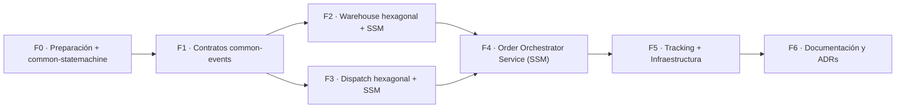
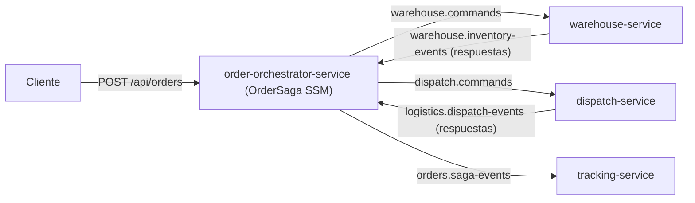
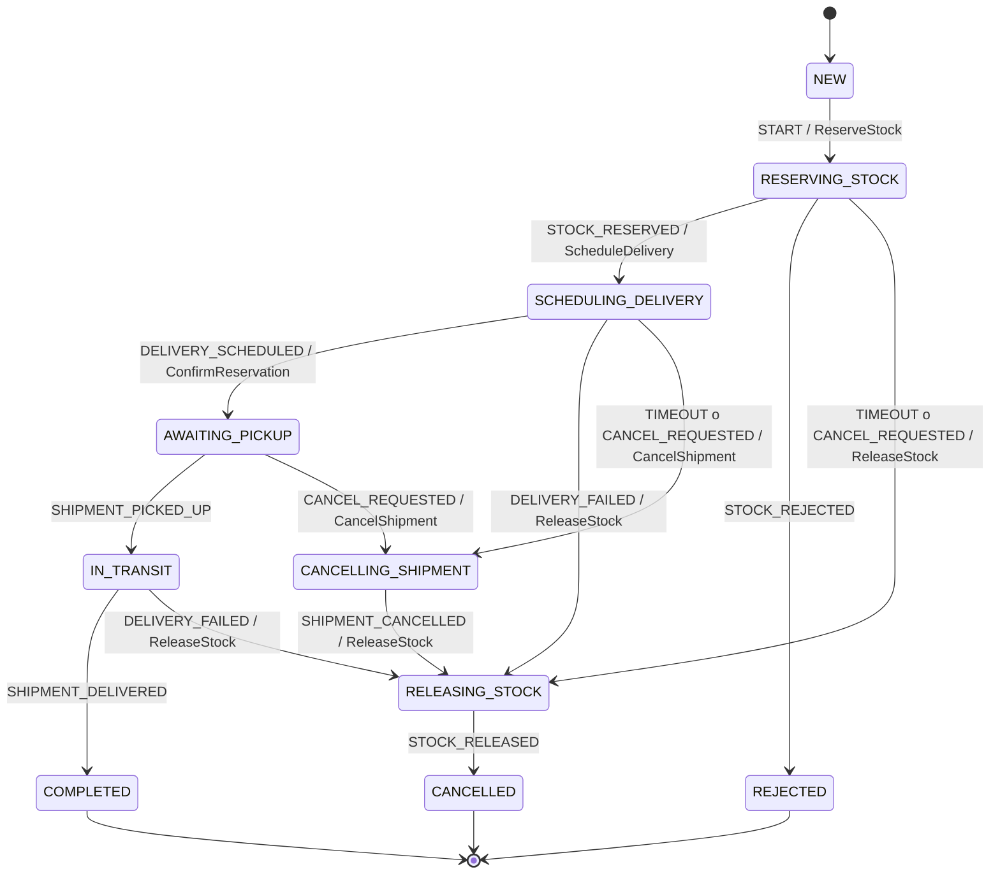

# Plan de implementación: Spring State Machine + Arquitectura Hexagonal

> FastDrop Logistics · `warehouse-service`, `dispatch-service`, `order-orchestrator-service` (nuevo) + módulo compartido `common-statemachine` (con impacto en `common-events` y `tracking-service`).

---

## 1. Contexto y objetivo

Hoy el ciclo de vida de los agregados está **implícito** en los servicios:

| Servicio | Agregado | Estados actuales | Problema |
|---|---|---|---|
| warehouse | `StockReservation` | `RESERVED`, `CONFIRMED`, `CANCELLED` | `CONFIRMED` nunca se alcanza; transiciones con `if` dispersos en [WarehouseService.java](file:///C:/Users/Noxie-PC/Documents/logistica/warehouse-service/src/main/java/com/fastdrop/warehouse/service/WarehouseService.java); stock insuficiente lanza una excepción y no queda rastro. |
| dispatch | `Shipment` | `SCHEDULED`, `IN_TRANSIT`, `DELIVERED`, `FAILED` | `IN_TRANSIT`/`DELIVERED` nunca se usan; el estado se asigna "a mano" en el builder dentro de [DispatchService.java](file:///C:/Users/Noxie-PC/Documents/logistica/dispatch-service/src/main/java/com/fastdrop/dispatch/service/DispatchService.java). |

Además, servicios, entidades JPA, listeners de Kafka y la lógica de outbox están acoplados en capas técnicas (`controller/`, `service/`, `repository/`).

**Objetivo:**
1. Hacer **explícitas y validadas** las transiciones de estado de cada agregado con **Spring State Machine (SSM)**.
2. Reorganizar cada servicio con **arquitectura hexagonal (Ports & Adapters)**, con SSM, JPA, Kafka y Resilience4j detrás de puertos.
3. Mantener la **saga coreografiada** (ADR-002) y el **Transactional Outbox** (ADR-001): SSM gobierna el ciclo de vida **local** de cada agregado, no orquesta la saga.

---

## 2. Decisiones clave

| # | Decisión | Elección | Motivo |
|---|---|---|---|
| D1 | Alcance de SSM | **Dos niveles**: máquina de proceso (`OrderSaga` en `order-orchestrator-service`) + máquinas de entidad (`StockReservation` en warehouse y `Shipment` en dispatch) | Con retiro, entrega, cancelación manual y timeouts se supera el umbral de ADR-002 (6 pasos y 4 ramas de compensación). |
| D2 | Instanciación | `@EnableStateMachineFactory`: una instancia nueva por evento y por agregado/saga | `@EnableStateMachine` es singleton y **no es seguro** para múltiples instancias concurrentes. |
| D3 | Persistencia del estado | **Rehidratación desde la columna `status`/`state` de la entidad** (sin `spring-statemachine-data-jpa`) | Una única fuente de verdad, misma transacción que el outbox, sin serialización Kryo. |
| D4 | Rol de SSM | Define transiciones + guards; las actions **solo invocan métodos del dominio en memoria** (sin I/O) | La lógica de negocio queda en el dominio; persistencia y outbox los maneja la capa de aplicación en una sola transacción. |
| D5 | Ubicación de SSM | Adaptador de salida en `infrastructure/adapter/out/statemachine` detrás de un puerto | Dominio y aplicación no dependen de `org.springframework.statemachine`. |
| D6 | Modelo de dominio vs JPA | Modelos de dominio puros + entidades JPA separadas + mappers | Dominio sin anotaciones de framework. |
| D7 | Eventos y Comandos | El dominio registra *domain events* / *saga commands* propios; el adaptador de outbox los mapea a los contratos de `common-events` | `common-events` funciona como contrato (*published language*), no como modelo interno. |
| D8 | Concurrencia | `@Version` en `OrderSaga`, `StockReservation` y `Shipment` + clave Kafka `orderId` | Evita transiciones concurrentes. |
| D9 | Código compartido de SSM | Nuevo módulo **`common-statemachine`**: puerto genérico sin framework (paquete `api`) + adaptador base de SSM (paquete `ssm`) | Evita duplicar la rehidratación, el envío y el manejo de errores entre warehouse, dispatch y el orquestador. |
| D10 | Entrega fallida | **Siempre devuelve el stock al warehouse** (`CONFIRMED → CANCELLED` con liberación de inventario) | Decisión de negocio: no se modela un flujo de devolución física. |
| D11 | Coordinación de Saga | **Saga Orquestada (`order-orchestrator-service`)** reemplaza a la coreografía (nuevo ADR-005 reemplaza ADR-002) | Los participantes (`warehouse`, `dispatch`) dejan de escucharse entre sí; solo consumen comandos del orquestador y emiten eventos de respuesta. |

> [!NOTE]
> **Todas las decisiones arquitectónicas (D1–D11) están confirmadas.**

> [!WARNING]
> **Spring Statemachine 4.0.x es la última versión open source.** El repositorio fue archivado (`spring-attic`) y las actualizaciones posteriores son solo comerciales (Tanzu). Funciona con Spring Boot 3.3.x, pero **no tiene camino de migración a Spring Boot 4**. La arquitectura hexagonal mitiga este riesgo: SSM queda aislado en un adaptador y se puede reemplazar (por ejemplo, por una tabla de transiciones propia) sin tocar el dominio ni la aplicación. Registrarlo en un **ADR-004**.

---

## 3. Arquitectura hexagonal

### 3.1 Vista general (igual para ambos servicios)


**Regla de dependencias:** `infrastructure → application → domain`. Nunca al revés.

### 3.2 Estructura de paquetes (ejemplo: warehouse)

```
com.fastdrop.warehouse
├── domain
│   ├── model
│   │   ├── StockReservation.java          # agregado puro (sin JPA)
│   │   ├── InventoryItem.java
│   │   ├── ReservationState.java          # enum de estados
│   │   └── ReservationEvent.java          # enum de eventos (triggers)
│   ├── event                              # domain events internos
│   │   ├── DomainEvent.java
│   │   ├── StockReserved.java
│   │   ├── StockReservationRejected.java
│   │   ├── ReservationConfirmed.java
│   │   └── StockReleased.java
│   └── exception
│       ├── ReservationNotFoundException.java   # las excepciones de transición vienen de common-statemachine
│       └── InventoryNotFoundException.java
├── application
│   ├── port
│   │   ├── in
│   │   │   ├── ReserveStockUseCase.java
│   │   │   ├── ConfirmReservationUseCase.java
│   │   │   ├── CancelReservationUseCase.java
│   │   │   ├── InitializeInventoryUseCase.java
│   │   │   └── command/ (ReserveStockCommand, CancelReservationCommand, ...)
│   │   └── out
│   │       ├── ReservationRepositoryPort.java
│   │       ├── InventoryRepositoryPort.java
│   │       ├── ReservationStateMachinePort.java
│   │       └── DomainEventPublisherPort.java
│   └── service
│       ├── ReservationService.java        # implementa Reserve/Confirm/Cancel UseCase
│       └── InventoryService.java
└── infrastructure
    ├── adapter
    │   ├── in
    │   │   ├── rest
    │   │   │   ├── WarehouseController.java
    │   │   │   ├── dto/ (ReserveStockRequest, InitInventoryRequest, ReservationResponse)
    │   │   │   └── RestExceptionHandler.java      # InvalidStateTransition → 409
    │   │   └── messaging
    │   │       ├── DispatchEventsKafkaListener.java
    │   │       └── SagaCommandsKafkaListener.java
    │   └── out
    │       ├── persistence
    │       │   ├── entity/ (StockReservationJpaEntity, InventoryItemJpaEntity, OutboxEventJpaEntity)
    │       │   ├── repository/ (Spring Data interfaces)
    │       │   ├── mapper/ (ReservationPersistenceMapper, ...)
    │       │   ├── ReservationPersistenceAdapter.java
    │       │   └── InventoryPersistenceAdapter.java
    │       ├── statemachine
    │       │   ├── ReservationStateMachineConfig.java
    │       │   ├── ReservationStateMachineAdapter.java    # extends AbstractStateMachineAdapter (common-statemachine)
    │       │   ├── ReservationHeaders.java                # solo headers propios (REASON, TRACKING_NUMBER)
    │       │   ├── guard/ (HasAvailableStockGuard)        # extends ContextAwareGuard
    │       │   └── action/ (ReserveStockAction, RejectReservationAction, ConfirmReservationAction, ReleaseStockAction)  # extends ContextAwareAction
    │       └── messaging
    │           ├── OutboxDomainEventPublisherAdapter.java  # domain event → common-events → outbox
    │           └── OutboxRelayWorker.java                  # ex OutboxPublisherWorker
    └── config
        └── BeanConfiguration.java (si hace falta)
```

`dispatch-service` sigue la misma forma, con `Shipment`, `ShipmentState`, `ShipmentEvent`, `RoutingPort` → `ExternalRoutingApiAdapter` (que hoy es [ExternalRoutingServiceClient.java](file:///C:/Users/Noxie-PC/Documents/logistica/dispatch-service/src/main/java/com/fastdrop/dispatch/client/ExternalRoutingServiceClient.java)).

---

## 4. Máquina de estados: `StockReservation` (warehouse)

### 4.1 Diagrama


### 4.2 Tabla de transiciones

| Origen | Evento (trigger) | Disparado por | Guard | Destino | Action (dominio) | Evento de integración (outbox) |
|---|---|---|---|---|---|---|
| `NEW` | `RESERVE` | `POST /api/orders/reserve` | `HasAvailableStockGuard` ✅ | `RESERVED` | `reservation.reserve(inventory)` | `StockReserved` |
| `NEW` | `RESERVE` | ídem | ❌ (rama `last` de la choice) | `REJECTED` | `reservation.reject(reason)` | `StockReservationRejected` **(nuevo)** |
| `RESERVED` | `CONFIRM` | Kafka `DeliveryScheduled` | — | `CONFIRMED` | `reservation.confirm(trackingNumber)` | — (opcional `ReservationConfirmed`) |
| `RESERVED` | `CANCEL` | Kafka `DeliveryFailed` / `CancelStockReservation` / REST | — | `CANCELLED` | `reservation.cancel(reason, inventory)` | `StockCancelled` |
| `CONFIRMED` | `CANCEL` | ídem | — | `CANCELLED` | ídem | `StockCancelled` |
| `CANCELLED` / `REJECTED` | cualquiera | — | — | **DENIED** | — | — (no-op idempotente) |

> [!NOTE]
> `NEW` y `STOCK_CHECK` **nunca se persisten**: `NEW` es el estado del agregado recién creado en memoria, y `STOCK_CHECK` es un pseudo-estado *choice*. Persistir `REJECTED` es una mejora: hoy una reserva sin stock no deja registro ni notifica a tracking.

> [!IMPORTANT]
> **Entrega fallida → el stock vuelve (D10).** Un `DeliveryFailed` puede llegar cuando la reserva ya está en `CONFIRMED` (falla después del retiro, `IN_TRANSIT → FAILED` en dispatch). La transición `CONFIRMED --CANCEL--> CANCELLED` ejecuta `ReleaseStockAction`, que devuelve la cantidad al inventario disponible. No hay estado intermedio de devolución física.

---

## 5. Máquina de estados: `Shipment` (dispatch)

### 5.1 Diagrama


### 5.2 Tabla de transiciones

| Origen | Evento | Disparado por | Guard | Destino | Action (dominio) | Evento de integración |
|---|---|---|---|---|---|---|
| — (creación) | — | Kafka `StockReserved` | — | `PENDING_ROUTING` | `Shipment.create(...)` | — |
| `PENDING_ROUTING` | `ROUTE_ASSIGNED` | Resultado exitoso de `RoutingPort` | `RouteResultPresentGuard` | `SCHEDULED` | `shipment.assignRoute(route)` | `DeliveryScheduled` |
| `PENDING_ROUTING` | `ROUTE_FAILED` | Fallback de Resilience4j | — | `FAILED` | `shipment.fail(reason)` | `DeliveryFailed` (dispara la compensación) |
| `SCHEDULED` | `PICK_UP` | `POST /api/shipments/{orderId}/pick-up` **(nuevo)** | `DriverMatchesGuard` | `IN_TRANSIT` | `shipment.pickUp(driverId)` | `ShipmentPickedUp` **(nuevo)** |
| `IN_TRANSIT` | `DELIVER` | `POST /api/shipments/{orderId}/deliver` **(nuevo)** | — | `DELIVERED` | `shipment.deliver()` | `ShipmentDelivered` **(nuevo)** |
| `IN_TRANSIT` | `DELIVERY_FAILED` | `POST /api/shipments/{orderId}/delivery-failed` **(nuevo)** | — | `FAILED` | `shipment.fail(reason)` | `DeliveryFailed` |
| `SCHEDULED` | `CANCEL` | Kafka `StockCancelled` (cancelación manual en warehouse) | — | `CANCELLED` | `shipment.cancel(reason)` | `ShipmentCancelled` **(nuevo)** |
| `FAILED` / `DELIVERED` / `CANCELLED` | cualquiera | — | — | **DENIED** | — | no-op idempotente |

> [!IMPORTANT]
> **Llamada externa fuera de la transacción.** Hoy la llamada a la API de ruteo (con retry y backoff, varios segundos) ocurre dentro de `@Transactional`. Con estados explícitos se divide en dos pasos:
> 1. **TX1:** crear `Shipment` en `PENDING_ROUTING` y hacer commit.
> 2. Llamar a `RoutingPort` **sin transacción**.
> 3. **TX2:** disparar `ROUTE_ASSIGNED` o `ROUTE_FAILED` y persistir el agregado y el outbox.
>
> Si el pod cae entre 1 y 3, un **`PendingRoutingRecoveryScheduler`** (adaptador de entrada) reintenta los `Shipment` que quedaron en `PENDING_ROUTING` más de N segundos. Esta mejora de resiliencia es posible gracias al estado explícito.

### 5.3 Evitar loops en la coreografía

`DeliveryFailed` → warehouse `CANCEL` → `StockCancelled` → dispatch recibe `CANCEL` en estado `FAILED` → **DENIED → no-op**. La regla "DENIED en estado terminal = ignorar y loguear" corta el ciclo sin lógica adicional.

---

## 6. Cómo se transiciona: mecánica completa

### 6.1 Secuencia (ejemplo: compensación por `DeliveryFailed`)


### 6.2 Dominio: enums y agregado

```java
// domain/model/ReservationState.java
public enum ReservationState { NEW, STOCK_CHECK, RESERVED, CONFIRMED, REJECTED, CANCELLED;
    public boolean isTerminal() { return this == REJECTED || this == CANCELLED; }
}

// domain/model/ReservationEvent.java
public enum ReservationEvent { RESERVE, CONFIRM, CANCEL }
```

```java
// domain/model/StockReservation.java  (POJO puro)
public class StockReservation {
    private UUID id;
    private String orderId;
    private String warehouseId;
    private String sku;
    private int quantity;
    private String deliveryAddress;
    private ReservationState state;
    private Long version;
    private final List<DomainEvent> domainEvents = new ArrayList<>();

    public static StockReservation create(String orderId, String sku, int qty, String address) {
        var r = new StockReservation();
        r.orderId = orderId; r.sku = sku; r.quantity = qty; r.deliveryAddress = address;
        r.state = ReservationState.NEW;
        return r;
    }

    // Invocados SOLO por las actions de la máquina (sin I/O)
    public void reserve(InventoryItem item) {
        item.reserve(quantity);
        this.warehouseId = item.getWarehouseId();
        domainEvents.add(new StockReserved(orderId, warehouseId, sku, quantity, deliveryAddress));
    }
    public void reject(String reason)                     { domainEvents.add(new StockReservationRejected(orderId, sku, quantity, reason)); }
    public void confirm(String trackingNumber)            { domainEvents.add(new ReservationConfirmed(orderId, trackingNumber)); }
    public void cancel(String reason, InventoryItem item) {
        item.release(quantity);
        domainEvents.add(new StockReleased(orderId, warehouseId, sku, quantity, reason));
    }

    // El estado lo fija la aplicación con el resultado de la máquina
    public void changeState(ReservationState newState) { this.state = newState; }
    public List<DomainEvent> pullDomainEvents() { var e = List.copyOf(domainEvents); domainEvents.clear(); return e; }
}
```

### 6.3 Puertos de la máquina de estados (módulo `common-statemachine`, paquete `api`)

```java
// com.fastdrop.statemachine.api — Java puro, sin dependencias de Spring
public interface TransitionSubject<S extends Enum<S>> {
    String machineId();      // id de correlación (orderId)
    S currentState();        // estado persistido desde el cual se rehidrata
}

public interface StateMachinePort<C extends TransitionSubject<S>, S extends Enum<S>, E extends Enum<E>> {
    TransitionResult<S> fire(C subject, E event, Map<String, Object> params);
}

public record TransitionResult<S extends Enum<S>>(boolean accepted, S source, S target) {
    public boolean changed() { return accepted && source != target; }
}

public class InvalidStateTransitionException extends RuntimeException { /* DENIED en estado no terminal */ }
public class StateTransitionFailedException extends RuntimeException { /* excepción dentro de una action */ }
```

En cada servicio, el puerto específico solo fija los tipos genéricos:

```java
// warehouse: application/port/out/ReservationStateMachinePort.java
public interface ReservationStateMachinePort
        extends StateMachinePort<ReservationContext, ReservationState, ReservationEvent> {}

// warehouse: application/port/out/ReservationContext.java — agregados que necesitan las actions
public record ReservationContext(StockReservation reservation, InventoryItem inventory)
        implements TransitionSubject<ReservationState> {
    public String machineId()              { return reservation.getOrderId(); }
    public ReservationState currentState() { return reservation.getState(); }
}
```

### 6.4 Configuración de SSM (adaptador)

```java
@Configuration
@EnableStateMachineFactory(name = "reservationStateMachineFactory")
@RequiredArgsConstructor
public class ReservationStateMachineConfig
        extends EnumStateMachineConfigurerAdapter<ReservationState, ReservationEvent> {

    private final HasAvailableStockGuard hasAvailableStock;
    private final ReserveStockAction reserveStock;
    private final RejectReservationAction rejectReservation;
    private final ConfirmReservationAction confirmReservation;
    private final ReleaseStockAction releaseStock;
    private final MetricsStateMachineListener metricsListener;   // de common-statemachine

    @Override
    public void configure(StateMachineConfigurationConfigurer<ReservationState, ReservationEvent> config) throws Exception {
        config.withConfiguration()
              .machineId("stock-reservation")
              .autoStartup(false)          // se arranca manualmente tras rehidratar
              .listener(metricsListener);
    }

    @Override
    public void configure(StateMachineStateConfigurer<ReservationState, ReservationEvent> states) throws Exception {
        states.withStates()
              .initial(NEW)
              .choice(STOCK_CHECK)
              .states(EnumSet.allOf(ReservationState.class))
              .end(REJECTED)
              .end(CANCELLED);
    }

    @Override
    public void configure(StateMachineTransitionConfigurer<ReservationState, ReservationEvent> t) throws Exception {
        t.withExternal().source(NEW).target(STOCK_CHECK).event(RESERVE)
         .and().withChoice().source(STOCK_CHECK)
                .first(RESERVED, hasAvailableStock, reserveStock)
                .last(REJECTED, rejectReservation)
         .and().withExternal().source(RESERVED).target(CONFIRMED).event(CONFIRM).action(confirmReservation)
         .and().withExternal().source(RESERVED).target(CANCELLED).event(CANCEL).action(releaseStock)
         .and().withExternal().source(CONFIRMED).target(CANCELLED).event(CANCEL).action(releaseStock);
    }
}
```

### 6.5 Adaptador: rehidratar, disparar y leer el resultado

La lógica genérica se escribe **una sola vez** en `common-statemachine` (paquete `ssm`):

```java
// com.fastdrop.statemachine.ssm.AbstractStateMachineAdapter
public abstract class AbstractStateMachineAdapter<C extends TransitionSubject<S>, S extends Enum<S>, E extends Enum<E>>
        implements StateMachinePort<C, S, E> {

    public static final String SUBJECT_HEADER = "fastdrop.sm.subject";
    public static final String ERROR_KEY = "fastdrop.sm.error";

    private final StateMachineFactory<S, E> factory;

    protected AbstractStateMachineAdapter(StateMachineFactory<S, E> factory) { this.factory = factory; }

    @Override
    public final TransitionResult<S> fire(C subject, E event, Map<String, Object> params) {
        S source = subject.currentState();
        StateMachine<S, E> sm = factory.getStateMachine(subject.machineId());
        try {
            // 1) Rehidratar desde el estado persistido del agregado
            sm.stopReactively().block();
            sm.getStateMachineAccessor().doWithAllRegions(acc ->
                    acc.resetStateMachineReactively(new DefaultStateMachineContext<>(source, null, null, null)).block());
            sm.startReactively().block();

            // 2) El subject (agregados) y los parámetros viajan como headers del mensaje
            Message<E> msg = MessageBuilder.withPayload(event)
                    .setHeader(SUBJECT_HEADER, subject)
                    .copyHeaders(params)
                    .build();

            // 3) Disparo síncrono (mismo hilo → misma transacción)
            StateMachineEventResult<S, E> result = sm.sendEvent(Mono.just(msg)).blockLast();

            // 4) SSM no propaga las excepciones de las actions: ContextAwareAction las deja en el extended state
            RuntimeException actionError = sm.getExtendedState().get(ERROR_KEY, RuntimeException.class);
            if (actionError != null) {
                throw new StateTransitionFailedException(subject.machineId(), source, event, actionError);
            }
            boolean accepted = result != null && result.getResultType() == StateMachineEventResult.ResultType.ACCEPTED;
            return new TransitionResult<>(accepted, source, sm.getState().getId());
        } finally {
            sm.stopReactively().block();
        }
    }
}
```

El adaptador concreto de cada servicio queda en pocas líneas:

```java
@Component
public class ReservationStateMachineAdapter
        extends AbstractStateMachineAdapter<ReservationContext, ReservationState, ReservationEvent>
        implements ReservationStateMachinePort {

    public ReservationStateMachineAdapter(
            @Qualifier("reservationStateMachineFactory") StateMachineFactory<ReservationState, ReservationEvent> factory) {
        super(factory);
    }
}
```

### 6.6 Guards y actions (delgados, delegan al dominio)

Las clases base del módulo compartido extraen el subject con su tipo y capturan los errores:

```java
// com.fastdrop.statemachine.ssm
public abstract class ContextAwareGuard<S, E, C> implements Guard<S, E> {
    @Override public final boolean evaluate(StateContext<S, E> ctx) { return test(StateContexts.subject(ctx), ctx); }
    protected abstract boolean test(C subject, StateContext<S, E> ctx);
}

public abstract class ContextAwareAction<S, E, C> implements Action<S, E> {
    @Override public final void execute(StateContext<S, E> ctx) {
        try {
            run(StateContexts.subject(ctx), ctx);
        } catch (RuntimeException ex) {
            ctx.getExtendedState().getVariables().put(AbstractStateMachineAdapter.ERROR_KEY, ex);
            throw ex;
        }
    }
    protected abstract void run(C subject, StateContext<S, E> ctx);
}
```

En warehouse:

```java
@Component
public class HasAvailableStockGuard extends ContextAwareGuard<ReservationState, ReservationEvent, ReservationContext> {
    @Override
    protected boolean test(ReservationContext c, StateContext<ReservationState, ReservationEvent> ctx) {
        return c.inventory() != null && c.inventory().hasAvailableStock(c.reservation().getQuantity());
    }
}

@Component
public class ReleaseStockAction extends ContextAwareAction<ReservationState, ReservationEvent, ReservationContext> {
    @Override
    protected void run(ReservationContext c, StateContext<ReservationState, ReservationEvent> ctx) {
        c.reservation().cancel((String) ctx.getMessageHeader(ReservationHeaders.REASON), c.inventory());
    }
}
```

### 6.7 Servicio de aplicación (caso de uso)

```java
@Service
@RequiredArgsConstructor
public class ReservationService implements ReserveStockUseCase, ConfirmReservationUseCase, CancelReservationUseCase {

    private final ReservationRepositoryPort reservations;
    private final InventoryRepositoryPort inventory;
    private final ReservationStateMachinePort stateMachine;
    private final DomainEventPublisherPort events;

    @Override
    @Transactional
    public StockReservation cancel(CancelReservationCommand cmd) {
        var reservation = reservations.findByOrderId(cmd.orderId())
                .orElseThrow(() -> new ReservationNotFoundException(cmd.orderId()));
        var item = inventory.findBySkuAndWarehouse(reservation.getSku(), reservation.getWarehouseId()).orElse(null);

        var result = stateMachine.fire(new ReservationContext(reservation, item), ReservationEvent.CANCEL,
                Map.of(ReservationHeaders.REASON, cmd.reason()));

        if (!result.accepted()) {
            if (reservation.getState().isTerminal()) {          // idempotencia (ADR-002)
                log.info("CANCEL ignorado: reserva {} ya en {}", cmd.orderId(), reservation.getState());
                return reservation;
            }
            throw new InvalidStateTransitionException(cmd.orderId(), result.source(), ReservationEvent.CANCEL);
        }

        reservation.changeState(result.target());
        reservations.save(reservation);
        if (item != null) inventory.save(item);
        events.publish(reservation.pullDomainEvents());          // → outbox en la misma TX
        return reservation;
    }
    // reserve(...) y confirm(...) siguen el mismo patrón: cargar/crear → fire → validar → aplicar → guardar → publicar
}
```

### 6.8 Adaptadores de entrada: mapeo de mensaje a trigger

| Adaptador | Mensaje entrante | Caso de uso | Trigger SSM |
|---|---|---|---|
| `WarehouseController` | `POST /api/orders/reserve` | `ReserveStockUseCase` | `RESERVE` |
| `WarehouseController` | `POST /api/orders/{id}/cancel` | `CancelReservationUseCase` | `CANCEL` |
| `DispatchEventsKafkaListener` | `DeliveryScheduled` **(nuevo consumo)** | `ConfirmReservationUseCase` | `CONFIRM` |
| `DispatchEventsKafkaListener` | `DeliveryFailed` | `CancelReservationUseCase` | `CANCEL` |
| `SagaCommandsKafkaListener` | `CancelStockReservation` | `CancelReservationUseCase` | `CANCEL` |
| `InventoryEventsKafkaListener` (dispatch) | `StockReserved` | `ScheduleShipmentUseCase` | creación + `ROUTE_ASSIGNED` / `ROUTE_FAILED` |
| `InventoryEventsKafkaListener` (dispatch) | `StockCancelled` **(nuevo consumo)** | `CancelShipmentUseCase` | `CANCEL` |
| `ShipmentController` (dispatch) | `POST .../pick-up`, `.../deliver`, `.../delivery-failed` **(nuevos)** | `PickUpUseCase`, `DeliverUseCase`, `ReportDeliveryFailureUseCase` | `PICK_UP`, `DELIVER`, `DELIVERY_FAILED` |

Manejo de errores en los adaptadores:
- **REST:** `InvalidStateTransitionException` → `409 Conflict`; `ReservationNotFoundException` → `404`.
- **Kafka:** `InvalidStateTransitionException` → log + DLQ (`DefaultErrorHandler` + `DeadLetterPublishingRecoverer`); `OptimisticLockingFailureException` → reintento con backoff. Hoy los listeners atrapan todas las excepciones (`catch (Exception e)`) y los mensajes se pierden en silencio; esto se corrige.

---

## 7. Persistencia, transacciones y concurrencia

| Tema | Regla |
|---|---|
| **Fuente de verdad** | Columna `status` de `stock_reservations` / `shipments`. SSM no persiste nada propio. |
| **Transacción** | La abre el servicio de aplicación (`@Transactional`). SSM corre **síncrono en el mismo hilo**: no configurar `TaskExecutor`/`Scheduler` asíncrono en la máquina, porque se perdería el contexto transaccional (ThreadLocal). |
| **Errores en actions** | SSM atrapa las excepciones de las actions. `ContextAwareAction` (módulo compartido) las guarda en el extended state y `AbstractStateMachineAdapter` las relanza como `StateTransitionFailedException` para que la transacción haga rollback. |
| **Locking optimista** | Agregar `@Version` a `StockReservationJpaEntity` y `ShipmentJpaEntity`. `InventoryItem` ya lo tiene. |
| **Idempotencia** | `DENIED` + estado terminal = no-op. `DENIED` + estado no terminal = `InvalidStateTransitionException`. |
| **Migración de datos** | `ddl-auto: update` alcanza para agregar `version` y los nuevos valores de enum (`EnumType.STRING`). Los valores existentes (`RESERVED`, `CANCELLED`, `SCHEDULED`, `FAILED`) siguen siendo válidos. Inicializar `version = 0` en filas existentes. *(Recomendado a futuro: Flyway.)* |
| **Trazabilidad** | `TraceUtils` deja de usarse en la capa de aplicación: lo usan solo los adaptadores (Kafka in setea el contexto, Outbox adapter lo lee y lo guarda en `trace_context`). |

---

## 8. Cambios por módulo

### 8.0 Nuevo módulo `common-statemachine`

```
common-statemachine/
├── pom.xml
└── src
    ├── main/java/com/fastdrop/statemachine
    │   ├── api                                   # Java puro → lo puede usar la capa application
    │   │   ├── TransitionSubject.java
    │   │   ├── StateMachinePort.java
    │   │   ├── TransitionResult.java
    │   │   ├── InvalidStateTransitionException.java
    │   │   └── StateTransitionFailedException.java
    │   └── ssm                                   # solo para adaptadores de infraestructura
    │       ├── AbstractStateMachineAdapter.java  # rehidratación + envío síncrono + propagación de errores
    │       ├── ContextAwareGuard.java
    │       ├── ContextAwareAction.java           # guarda las excepciones en el extended state
    │       ├── StateContexts.java                # helper tipado para leer el subject de los headers
    │       └── MetricsStateMachineListener.java  # logs + contador Micrometer fastdrop.sm.transitions{machine,source,target}
    └── test/java/com/fastdrop/statemachine/ssm
        └── AbstractStateMachineAdapterTest.java  # máquina de prueba: rehidratación, DENIED y error en action
```

```xml
<!-- common-statemachine/pom.xml (dependencias) -->
<dependency>
    <groupId>org.springframework.statemachine</groupId>
    <artifactId>spring-statemachine-starter</artifactId>
</dependency>
<dependency>
    <groupId>io.micrometer</groupId>
    <artifactId>micrometer-core</artifactId>
</dependency>
<dependency>
    <groupId>org.springframework.statemachine</groupId>
    <artifactId>spring-statemachine-test</artifactId>
    <scope>test</scope>
</dependency>
```

> [!NOTE]
> Los paquetes `api` y `ssm` conviven en un solo módulo para no multiplicar artefactos. ArchUnit impide que la capa `application` use `..statemachine.ssm..` (ver sección 9). Si más adelante se quiere una separación física, `api` se puede extraer a `common-statemachine-api` sin cambiar código.

### 8.1 Raíz `pom.xml`

```xml
<modules>
    <module>common-events</module>
    <module>common-statemachine</module>   <!-- nuevo -->
    <module>warehouse-service</module>
    <module>dispatch-service</module>
    <module>tracking-service</module>
</modules>

<properties>
    <spring-statemachine.version>4.0.0</spring-statemachine.version>  <!-- última 4.0.x OSS disponible -->
    <archunit.version>1.3.0</archunit.version>
</properties>

<dependencyManagement>
    <dependencies>
        <dependency>
            <groupId>org.springframework.statemachine</groupId>
            <artifactId>spring-statemachine-bom</artifactId>
            <version>${spring-statemachine.version}</version>
            <type>pom</type>
            <scope>import</scope>
        </dependency>
        <dependency>
            <groupId>com.tngtech.archunit</groupId>
            <artifactId>archunit-junit5</artifactId>
            <version>${archunit.version}</version>
        </dependency>
        <dependency>
            <groupId>com.fastdrop</groupId>
            <artifactId>common-statemachine</artifactId>
            <version>${project.version}</version>
        </dependency>
    </dependencies>
</dependencyManagement>
```

### 8.2 `warehouse-service/pom.xml` y `dispatch-service/pom.xml`

```xml
<dependency>
    <groupId>com.fastdrop</groupId>
    <artifactId>common-statemachine</artifactId>   <!-- trae spring-statemachine-starter de forma transitiva -->
</dependency>
<dependency>
    <groupId>org.springframework.statemachine</groupId>
    <artifactId>spring-statemachine-test</artifactId>
    <scope>test</scope>
</dependency>
<dependency>
    <groupId>com.tngtech.archunit</groupId>
    <artifactId>archunit-junit5</artifactId>
    <scope>test</scope>
</dependency>
```

### 8.3 `common-events`

| Acción | Archivo |
|---|---|
| [NEW] | `event/StockReservationRejectedEvent.java` |
| [NEW] | `event/ShipmentPickedUpEvent.java` |
| [NEW] | `event/ShipmentDeliveredEvent.java` |
| [NEW] | `event/ShipmentCancelledEvent.java` |
| [MODIFY] | [ShipmentTrackingDTO.java](file:///C:/Users/Noxie-PC/Documents/logistica/common-events/src/main/java/com/fastdrop/common/dto/ShipmentTrackingDTO.java): actualizar el comentario de `status` con los nuevos estados |

### 8.4 `warehouse-service`

| Acción | Origen actual | Destino |
|---|---|---|
| [MOVE+SPLIT] | `domain/StockReservation.java` | `domain/model/StockReservation.java` (POJO) + `infrastructure/adapter/out/persistence/entity/StockReservationJpaEntity.java` (+ `@Version`) |
| [MOVE+SPLIT] | `domain/InventoryItem.java` | `domain/model/InventoryItem.java` + `...persistence/entity/InventoryItemJpaEntity.java` |
| [MOVE] | `domain/OutboxEvent.java` | `...persistence/entity/OutboxEventJpaEntity.java` (no es dominio) |
| [MOVE] | `repository/*` | `...persistence/repository/*` (Spring Data, package-private si es posible) |
| [REPLACE] | `service/WarehouseService.java` | `application/service/ReservationService.java` + `InventoryService.java` |
| [MOVE] | `controller/WarehouseController.java` | `infrastructure/adapter/in/rest/` (depende solo de puertos de entrada; deja de inyectar `InventoryRepository`) |
| [MOVE] | `dto/ReserveStockRequest.java` | `infrastructure/adapter/in/rest/dto/` |
| [SPLIT] | `listener/SagaCompensationListener.java` | `DispatchEventsKafkaListener` + `SagaCommandsKafkaListener` (agrega `DeliveryScheduled` → CONFIRM) |
| [MOVE] | `outbox/OutboxPublisherWorker.java` | `infrastructure/adapter/out/messaging/OutboxRelayWorker.java` |
| [NEW] | — | `domain/model/ReservationState.java`, `ReservationEvent.java`, `domain/event/*`, `domain/exception/*` |
| [NEW] | — | `application/port/in/*`, `application/port/out/*` |
| [NEW] | — | `infrastructure/adapter/out/statemachine/*` (config, adapter, guards, actions; heredan de las clases base de `common-statemachine`) |
| [NEW] | — | `infrastructure/adapter/out/persistence/*Adapter.java` + mappers |
| [NEW] | — | `infrastructure/adapter/out/messaging/OutboxDomainEventPublisherAdapter.java` |
| [NEW] | — | `infrastructure/adapter/in/rest/RestExceptionHandler.java` |

### 8.5 `dispatch-service`

| Acción | Origen actual | Destino |
|---|---|---|
| [MOVE+SPLIT] | `domain/Shipment.java` | `domain/model/Shipment.java` + `ShipmentJpaEntity` (+ `@Version`); enum → `ShipmentState` |
| [NEW] | — | `domain/model/ShipmentEvent.java`, `domain/model/RouteAssignment.java` (VO) |
| [REPLACE] | `service/DispatchService.java` | `application/service/ShipmentService.java` (Schedule, PickUp, Deliver, ReportFailure, Cancel) con TX1 / llamada externa / TX2 vía `TransactionTemplate` |
| [MOVE] | `client/ExternalRoutingServiceClient.java` | `infrastructure/adapter/out/routing/ExternalRoutingApiAdapter.java` implementa `RoutingPort` (conserva Circuit Breaker, Retry y fallback) |
| [MOVE] | `client/RouteAssignmentResult.java` | `application/port/out/RouteResult.java` (record) |
| [MOVE] | `listener/StockReservedEventListener.java` | `infrastructure/adapter/in/messaging/InventoryEventsKafkaListener.java` (+ `StockCancelled` → CANCEL) |
| [MOVE+MODIFY] | `controller/DispatchController.java` | `infrastructure/adapter/in/rest/ShipmentController.java` + endpoints `pick-up`, `deliver`, `delivery-failed` |
| [NEW] | — | `infrastructure/adapter/in/scheduler/PendingRoutingRecoveryScheduler.java` |
| [NEW] | — | `infrastructure/adapter/out/statemachine/*` (`ShipmentStateMachineConfig`, adapter, guards, actions) |

### 8.6 `tracking-service` (sin SSM)

Tracking es un **read model / proyección**, así que no necesita máquina de estados. Cambios mínimos:
- [MODIFY] [TrackingKafkaEventListener.java](file:///C:/Users/Noxie-PC/Documents/logistica/tracking-service/src/main/java/com/fastdrop/tracking/listener/TrackingKafkaEventListener.java): consumir `StockReservationRejected`, `ShipmentPickedUp`, `ShipmentDelivered` y `ShipmentCancelled`.
- [MODIFY] [TrackingService.java](file:///C:/Users/Noxie-PC/Documents/logistica/tracking-service/src/main/java/com/fastdrop/tracking/service/TrackingService.java): ignorar eventos que hagan *retroceder* el estado (orden de precedencia de estados), por si llegan fuera de orden.
- *(Opcional)* Aplicar la misma estructura hexagonal por consistencia.

---

## 9. Estrategia de testing

| Nivel | Qué | Herramienta |
|---|---|---|
| Dominio | Invariantes de `StockReservation`, `InventoryItem` y `Shipment` (sin Spring) | JUnit 5 |
| Configuración SSM | Cada transición válida, cada transición DENIED y las ramas de la choice | `StateMachineTestPlanBuilder` (`spring-statemachine-test`) |
| Aplicación | Casos de uso con puertos mockeados: ACCEPTED → guarda y publica; DENIED terminal → no-op; DENIED no terminal → excepción | JUnit 5 + Mockito (reemplaza los tests actuales [WarehouseServiceTest.java](file:///C:/Users/Noxie-PC/Documents/logistica/warehouse-service/src/test/java/com/fastdrop/warehouse/service/WarehouseServiceTest.java) y [DispatchServiceTest.java](file:///C:/Users/Noxie-PC/Documents/logistica/dispatch-service/src/test/java/com/fastdrop/dispatch/service/DispatchServiceTest.java)) |
| Adaptador SSM | Rehidratación desde cada estado + propagación de errores de actions | `@SpringBootTest(classes = ReservationStateMachineConfig.class, ...)` |
| Persistencia + outbox | Atomicidad estado + outbox, conflicto de `@Version` | `@DataJpaTest` (H2 ya está en el classpath) |
| Arquitectura | Reglas de dependencias hexagonales | ArchUnit |

Ejemplo de reglas ArchUnit:

```java
@AnalyzeClasses(packages = "com.fastdrop.warehouse")
class HexagonalArchitectureTest {
    @ArchTest static final ArchRule domainIsPure = noClasses().that().resideInAPackage("..domain..")
            .should().dependOnClassesThat().resideInAnyPackage("org.springframework..", "jakarta.persistence..", "..infrastructure..", "..application..");

    @ArchTest static final ArchRule appDoesNotKnowInfra = noClasses().that().resideInAPackage("..application..")
            .should().dependOnClassesThat().resideInAnyPackage("..infrastructure..", "org.springframework.statemachine..",
                    "com.fastdrop.statemachine.ssm..", "org.springframework.kafka..", "jakarta.persistence..");
    // permitido: com.fastdrop.statemachine.api.. (puerto genérico, Java puro)
}
```

> [!NOTE]
> Concesión pragmática: la capa `application` puede usar `@Service` y `@Transactional` (spring-context / spring-tx). Si se busca pureza total, se registran los beans en `infrastructure/config` y la transacción se maneja con un decorador.

---

## 10. Fases de implementación



- [ ] **F0 · Preparación y módulo compartido**
  - [ ] Dependencias SSM (`4.0.0`), `spring-statemachine-test` y ArchUnit (`1.3.0`) en el `pom.xml` raíz.
  - [ ] Crear el módulo `common-statemachine` (`api` + `ssm`: `TransitionSubject`, `StateMachinePort`, `AbstractStateMachineAdapter`, `ContextAwareGuard`, `ContextAwareAction`, `MetricsStateMachineListener`) con sus tests unitarios.
- [ ] **F1 · Contratos en `common-events`**
  - [ ] Eventos nuevos: `StockReservationRejectedEvent`, `ShipmentPickedUpEvent`, `ShipmentDeliveredEvent`, `ShipmentCancelledEvent`.
  - [ ] Comandos del orquestador: `ReserveStockCommand`, `ConfirmReservationCommand`, `ReleaseStockCommand`, `ScheduleDeliveryCommand`, `CancelShipmentCommand`.
  - [ ] Actualizar `ShipmentTrackingDTO`.
- [ ] **F2 · `warehouse-service` hexagonal + SSM**
  - [ ] Separar dominio puro (`StockReservation`, `InventoryItem`, `ReservationState`, `ReservationEvent`) de entidades JPA (`*JpaEntity` con `@Version`) + mappers + adaptadores.
  - [ ] Implementar `ReservationStateMachineConfig`, guards, actions y `ReservationStateMachineAdapter` (heredando de `common-statemachine`).
  - [ ] Implementar casos de uso (`ReserveStockUseCase`, `ConfirmReservationUseCase`, `CancelReservationUseCase`) + soporte *tombstone* en cancelación adelantada.
  - [ ] Adaptador de entrada `WarehouseCommandsKafkaListener` (`warehouse.commands`) y endpoints REST + `RestExceptionHandler`.
  - [ ] Tests con `StateMachineTestPlanBuilder`, tests de casos de uso y test ArchUnit.
- [ ] **F3 · `dispatch-service` hexagonal + SSM**
  - [ ] Separar dominio puro (`Shipment`, `ShipmentState`, `ShipmentEvent`, `RouteAssignment`) de `ShipmentJpaEntity` (`@Version`).
  - [ ] Implementar `ShipmentStateMachineConfig` (incluyendo `PENDING_ROUTING --CANCEL--> CANCELLED`), guards, actions y adaptador.
  - [ ] Separar TX1 (`PENDING_ROUTING`) / llamada a `RoutingPort` fuera de TX / TX2 (`ROUTE_ASSIGNED` o `ROUTE_FAILED`) + `PendingRoutingRecoveryScheduler`.
  - [ ] Adaptador `DispatchCommandsKafkaListener` (`dispatch.commands`) y endpoints REST (`pick-up`, `deliver`, `delivery-failed`).
  - [ ] Tests de máquina de estados, casos de uso y ArchUnit.
- [ ] **F4 · Nuevo `order-orchestrator-service` (`:8084`)**
  - [ ] Crear módulo Maven con estructura hexagonal, dominio `OrderSaga`, `SagaState`, `SagaEvent` y comandos salientes.
  - [ ] Configurar `SagaStateMachineConfig` y `SagaStateMachineAdapter` sobre `common-statemachine`.
  - [ ] Implementar `OrderSagaService`, idempotencia de respuestas (`ProcessedMessageJpaEntity`), `OutboxSagaCommandPublisherAdapter` y `SagaTimeoutScheduler`.
  - [ ] Endpoints REST (`POST /api/orders`, `POST /api/orders/{id}/cancel`, `GET /api/orders/{id}`) y `ParticipantRepliesKafkaListener`.
  - [ ] Tests del flujo completo de la saga (camino feliz, rechazo de stock, fallo en ruteo, fallo en entrega `IN_TRANSIT`, cancelación manual y timeout) + ArchUnit.
- [ ] **F5 · Tracking e infraestructura**
  - [ ] Actualizar `tracking-service` para proyectar los nuevos eventos y proteger contra eventos fuera de orden.
  - [ ] Actualizar `docker/init-databases.sql` (`orchestrator_db`), `docker-compose.yml` y manifiestos en `k8s/base/`.
- [ ] **F6 · Documentación**
  - [ ] Redactar `docs/adr/0004-spring-state-machine-hexagonal.md` y `docs/adr/0005-orchestrated-saga-state-machine.md` (actualizando el estado de ADR-002 a *Superseded*).
  - [ ] Actualizar diagramas C4 (`containers.puml`, `components.puml`) y `README.md`.

---

## 11. Riesgos

| Riesgo | Mitigación |
|---|---|
| SSM sin soporte OSS futuro / sin compatibilidad con Boot 4 | Aislado detrás de `*StateMachinePort`; reemplazable sin tocar dominio ni aplicación. |
| Excepciones de actions "tragadas" por SSM | `ContextAwareAction` + `AbstractStateMachineAdapter` las propagan; test dedicado en `common-statemachine`. |
| Pérdida del contexto transaccional si SSM corre asíncrono | No configurar executors en la máquina; test de rollback. |
| Costo de crear una máquina por evento | Es bajo para este volumen. Si hiciera falta, se puede agregar pooling de instancias más adelante. |
| Refactor grande (big bang) | Fases separadas: hexagonal sin cambio funcional primero, después SSM. |

---

## 12. Decisiones cerradas

- ✅ **Esquema con Orquestador (`order-orchestrator-service`):** La saga se coordina de forma centralizada con SSM (D1, D11) y cada participante mantiene su máquina de estados local para validar sus invariantes.
- ✅ **Entrega fallida devuelve stock:** Si falla la entrega en cualquier punto (incluido `IN_TRANSIT`), el stock vuelve al warehouse (`CONFIRMED → CANCELLED`, D10).
- ✅ **Dominio separado de las entidades JPA:** Modelos de dominio puros + entidades JPA con mappers en infraestructura (D6).
- ✅ **Módulo compartido `common-statemachine`:** Reutilizado por `warehouse-service`, `dispatch-service` y `order-orchestrator-service` (D9).

---

## 13. Diseño del Orquestador (`order-orchestrator-service`)

### 13.1 Idea general

En lugar de que cada servicio reaccione a los eventos del otro, **`order-orchestrator-service` es dueño del proceso completo** (`OrderSaga`): envía **comandos** a cada participante y avanza según las **respuestas** (los eventos que los participantes publican en sus tópicos).

Quedan **dos niveles** de máquinas de estado, ambos con `common-statemachine`:

| Nivel | Dónde | Qué modela |
|---|---|---|
| Proceso | `order-orchestrator-service` → `OrderSaga` | En qué paso está la orden y qué compensación corresponde |
| Entidad | warehouse → `StockReservation`; dispatch → `Shipment` | Qué transiciones admite cada agregado (**sin cambios** respecto de las secciones 4 y 5) |



Warehouse y dispatch **dejan de escucharse entre sí**: cada uno consume solo su tópico de comandos.

### 13.2 Máquina de estados `OrderSaga`



`IN_TRANSIT --DELIVERY_FAILED--> RELEASING_STOCK` aplica la decisión D10: si la entrega falla, el stock vuelve al warehouse.

### 13.3 Mensajes entrantes → triggers de la saga

| Mensaje recibido | Origen | Trigger `OrderSaga` |
|---|---|---|
| `POST /api/orders` | REST | `START` |
| `POST /api/orders/{id}/cancel` | REST | `CANCEL_REQUESTED` |
| `StockReserved` | `warehouse.inventory-events` | `STOCK_RESERVED` |
| `StockReservationRejected` | `warehouse.inventory-events` | `STOCK_REJECTED` |
| `StockCancelled` | `warehouse.inventory-events` | `STOCK_RELEASED` |
| `DeliveryScheduled` | `logistics.dispatch-events` | `DELIVERY_SCHEDULED` |
| `DeliveryFailed` | `logistics.dispatch-events` | `DELIVERY_FAILED` |
| `ShipmentPickedUp` | `logistics.dispatch-events` | `SHIPMENT_PICKED_UP` |
| `ShipmentDelivered` | `logistics.dispatch-events` | `SHIPMENT_DELIVERED` |
| `ShipmentCancelled` | `logistics.dispatch-events` | `SHIPMENT_CANCELLED` |
| Deadline vencido | `SagaTimeoutScheduler` | `TIMEOUT` |

### 13.4 Comandos salientes (nuevos en `common-events`)

| Comando | Tópico | Participante | Caso de uso que invoca | Trigger local |
|---|---|---|---|---|
| `ReserveStockCommand` | `warehouse.commands` | warehouse | `ReserveStockUseCase` | `RESERVE` |
| `ConfirmReservationCommand` | `warehouse.commands` | warehouse | `ConfirmReservationUseCase` | `CONFIRM` |
| `ReleaseStockCommand` (reemplaza `CancelStockReservationCommand`) | `warehouse.commands` | warehouse | `CancelReservationUseCase` | `CANCEL` |
| `ScheduleDeliveryCommand` | `dispatch.commands` | dispatch | `ScheduleShipmentUseCase` | creación + `ROUTE_ASSIGNED` / `ROUTE_FAILED` |
| `CancelShipmentCommand` | `dispatch.commands` | dispatch | `CancelShipmentUseCase` | `CANCEL` |

La saga guarda los datos de la orden (sku, cantidad, dirección) y el `warehouseId` que llega en `StockReserved`, para poder armar `ScheduleDeliveryCommand`.

### 13.5 Estructura hexagonal del orquestador

```
order-orchestrator-service   (:8084, base orchestrator_db)
com.fastdrop.orchestrator
├── domain
│   ├── model
│   │   ├── OrderSaga.java            # orderId, sku, qty, address, warehouseId, trackingNumber, state, deadline, version
│   │   ├── SagaState.java
│   │   └── SagaEvent.java
│   └── command/                      # comandos que la saga "pide" enviar (ReserveStock, ScheduleDelivery, ...)
├── application
│   ├── port/in    StartOrderUseCase, CancelOrderUseCase, HandleParticipantReplyUseCase, HandleSagaTimeoutUseCase
│   ├── port/out   OrderSagaRepositoryPort, SagaStateMachinePort, SagaCommandPublisherPort, ProcessedMessagePort
│   └── service    OrderSagaService
└── infrastructure
    ├── adapter/in/rest           OrderController (POST /api/orders, POST /api/orders/{id}/cancel, GET /api/orders/{id})
    ├── adapter/in/messaging      ParticipantRepliesKafkaListener (inventory-events + dispatch-events)
    ├── adapter/in/scheduler      SagaTimeoutScheduler
    ├── adapter/out/statemachine  SagaStateMachineConfig, SagaStateMachineAdapter (extends AbstractStateMachineAdapter), actions
    ├── adapter/out/persistence   OrderSagaJpaEntity, ProcessedMessageJpaEntity, OutboxEventJpaEntity + adapters
    └── adapter/out/messaging     OutboxSagaCommandPublisherAdapter, OutboxRelayWorker (enruta por tipo de comando al tópico)
```

### 13.6 Puntos clave de implementación

1. **Comandos por outbox.** Las actions de la saga no publican nada: registran el comando en el agregado (`saga.requestCommand(new ReserveStock(...))`). La aplicación lo escribe en `outbox_events` en la misma transacción que el nuevo estado, igual que en los participantes.
2. **Correlación.** `sagaId = orderId`, que también es la clave de partición en Kafka. Así se conserva el orden de los mensajes de cada orden.
3. **Idempotencia de respuestas.** Tabla `processed_messages` (inbox) con el `eventId` de cada respuesta, más la regla "DENIED en estado terminal = no-op".
4. **Timeouts sin timers de SSM.** `timerOnce` no sirve, porque la máquina se crea y se descarta en cada evento. En su lugar, la saga guarda un `deadline` al entrar en cada estado de espera, y `SagaTimeoutScheduler` dispara `TIMEOUT` sobre las sagas vencidas (`WHERE deadline < now() FOR UPDATE SKIP LOCKED`).
5. **Compensaciones seguras ante carreras.** Si `ReleaseStock` llega a warehouse antes que `ReserveStock` (por un timeout), warehouse crea la reserva directamente en `CANCELLED` (*tombstone*) y responde `StockCancelled`. Un `ReserveStock` tardío encuentra la reserva terminal y no hace nada. Lo mismo vale para `CancelShipment` en dispatch, para lo cual hay que agregar `PENDING_ROUTING --CANCEL--> CANCELLED` en la máquina de `Shipment`.
6. **En los participantes solo cambian los adaptadores de entrada de Kafka**: pasan de escuchar eventos del otro servicio a escuchar comandos. Casos de uso, dominio y máquinas locales no cambian. Esta es la ventaja concreta de hacer la hexagonal antes. Lo único que se descarta de F2/F4 son los consumos cruzados (`DeliveryScheduled` en warehouse y `StockCancelled` en dispatch).
7. **Punto de entrada.** `POST /api/orders/reserve` de warehouse se depreca; el cliente usa `POST /api/orders` del orquestador. La cancelación manual pasa a `POST /api/orders/{id}/cancel`.
8. **Infraestructura.** Agregar `orchestrator_db` en [init-databases.sql](file:///C:/Users/Noxie-PC/Documents/logistica/docker/init-databases.sql), el servicio en [docker-compose.yml](file:///C:/Users/Noxie-PC/Documents/logistica/docker-compose.yml), `orchestrator-deployment.yaml` en `k8s/base` y los tópicos `warehouse.commands`, `dispatch.commands` y `orders.saga-events`.
9. **Tracking.** Puede seguir consumiendo los eventos de los participantes, o consumir solo `OrderSagaStateChanged`, que da una única fuente para el estado de la orden.

### 13.7 Comparación

| Criterio | Coreografía + SSM local (F1–F6) | Orquestador con SSM (F7) |
|---|---|---|
| Visibilidad del flujo | Repartida entre 2 servicios | Un diagrama único y estado consultable (`GET /api/orders/{id}`) |
| Acoplamiento | Cada servicio conoce los eventos del otro | Los participantes no se conocen; cada uno conoce solo sus comandos |
| Timeouts / órdenes trabadas | Difícil: nadie es dueño del proceso | Nativo (deadline + scheduler) |
| Cancelación manual | Requiere eventos cruzados (`StockCancelled` → dispatch) | Un único comando al orquestador |
| Componentes nuevos | Ninguno | 1 servicio + 1 base + 3 tópicos |
| Punto único de falla | No | Sí (mitigable: servicio sin estado en memoria, réplicas, estado en DB) |
| Exposición al riesgo de SSM | 2 servicios | 3 servicios (mitigado con el módulo compartido) |

### 13.8 Recomendación

ADR-002 fijó como umbral para orquestar "más de 5–6 pasos con ramificaciones complejas". Con retiro, entrega, cancelación manual y timeouts, el flujo llega a **6 pasos y 4 ramas de compensación**, así que **el umbral se cumple**.

Recomiendo:
1. Hacer **F0–F6**, que hacen falta en cualquier escenario (hexagonal, máquinas locales y módulo compartido).
2. Implementar **F7** migrando solo los adaptadores de entrada de los participantes.
3. Escribir un **ADR-005** que reemplace a ADR-002 (de coreografía a orquestación).
